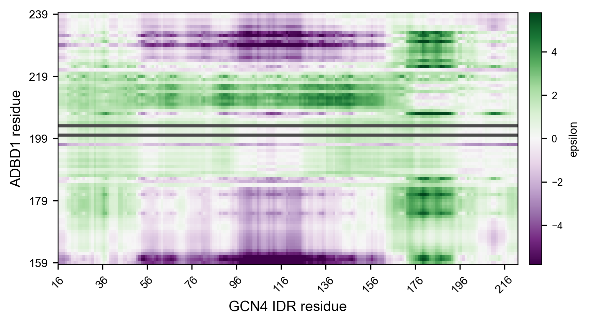
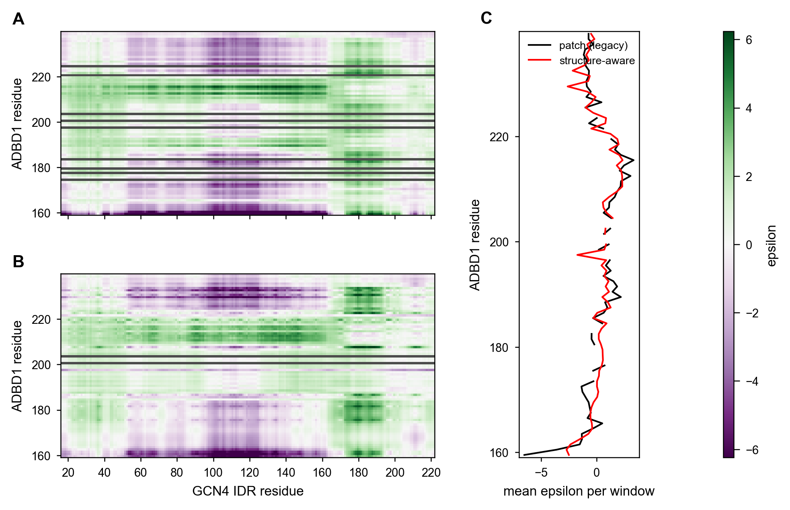
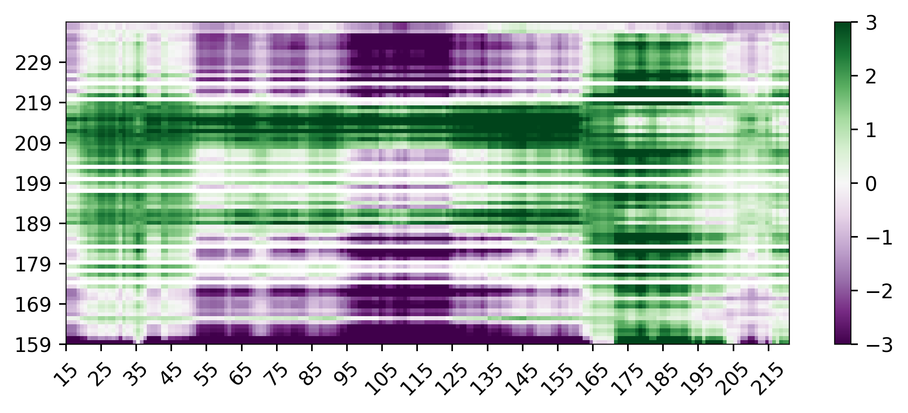

Predicting IDR:folded domain interactions
=============================================

FINCHES can score an intrinsically disordered region (IDR) against the surface of a folded domain and draw the result as a surface:IDR intermap: one row per residue of the structure, one column per sliding window of the IDR, with the same purple (attractive) to green (repulsive) colour scheme as an IDR:IDR intermap. There are two ways to build that map.

* **The structure-aware mode** (``finches.utils.structure_surface.StructureSurface``) is the newer approach and the one we recommend for all new work. It decomposes the structure into folded domains and IDRs, finds the contiguous folded surface, and scores each surface residue against the contact footprint an IDR window can actually reach.
* **The patch mode** (``finches.utils.folded_domain_utils.FoldedDomain``) is the original approach. It groups surface residues into straight-line patches and scores each patch as if it were a short sequence. It is kept so that earlier analyses can be reproduced, but it is superseded by the structure-aware mode.

The two modes agree on the major features of a map, and where they differ the structure-aware mode is the one that reflects the structure (see `Why the structure-aware mode is the better one`_ below).

.. note::

   The structure-aware mode is still under active development. Its polymer-reach parameters, contact radius and surface thresholds are physically motivated defaults rather than fitted values, so expect the defaults, and therefore the absolute numbers, to change. See :doc:`intermap_caveats` before over-interpreting fine differences between maps.

The two modes at a glance
-------------------------

.. list-table::
   :header-rows: 1
   :widths: 18 41 41

   * - Stage
     - Structure-aware mode (``StructureSurface``, recommended)
     - Patch mode (``FoldedDomain``, legacy)
   * - What counts as folded
     - metapredict splits each chain into folded domains and IDRs; residues missing from the coordinates can be supplied and are treated as IDR
     - every protein residue in the file
   * - Surface classification
     - SASA on the folded-domain atoms only, so a disordered tail cannot occlude the surface
     - SASA on the whole structure, including any tail packed against the domain
   * - Neighbourhood of a surface residue
     - a contiguous-surface net: neighbours must share a continuous surface, and distances are measured over the surface
     - every surface residue within a 12 Å straight-line ball
   * - Local chemistry for the charge and aliphatic weighting
     - the residue's real three-dimensional neighbours
     - the patch laid out as a pseudo-sequence in residue-index order
   * - How a window meets the surface
     - a window-sized contact footprint centred on the residue, weighted by a polymer model
     - every window residue sees the same flat patch average
   * - Rows in the output
     - every residue: buried residues blank, the structure's own IDR residues scored on the same scale
     - every residue: non-surface residues blank
   * - Extras
     - cis (tethered) and trans maps, multi-chain assemblies, mmCIF, PDB files for colouring structures, a plotting helper
     - none

The structure-aware mode (recommended)
--------------------------------------

Quick start
...........

.. code-block:: python

    from finches import Mpipi_frontend
    from finches.utils.structure_surface import StructureSurface

    mf = Mpipi_frontend()

    # the GCN4 N-terminal IDR
    gcn4_ntd = 'MSEYQPSLFALNPMGFSPLDGSKSTNENVSASTSTAKPMVGQLIFDKFIKTEEDPIIKQDTPSNLDFDFALPQTATAPDAKTVLPIPELDDAVVESFFSSSTDSTPMFEYENLEDNSKEWTSLFDNDIPVTTDDVSLADKAIESTEEVSLVPSNLEVSTTSFLPTPVLEDAKLTQTRKVKKPNSVVKKSHHVGKDDESRLDHLGVVAYNRKQRSIPLSPIVPESSDPAALKRARNT'

    # decompose the structure, classify the surface and build the surface net
    ss = StructureSurface('ADBD1.pdb', mf)
    print(ss)

    # a trans map: the IDR is a separate molecule. structure_offset places the
    # domain in its full-length protein for the y-axis labels
    fig, ax, (X, keys, centres) = ss.plot_surface_vs_idr_matrix(
        gcn4_ntd, window_size=31, structure_offset=158,
        xlabel='GCN4 IDR residue', ylabel='ADBD1 residue')

    # a cis map: the IDR is tethered to the structure. idr_tether() resolves the
    # anchor residue and which terminus of the IDR is attached to it straight
    # from the decomposition (here ADBD1's own N-terminal IDR segment)
    anchor, tether = ss.idr_tether(0)
    fig, ax, (X_cis, _, _) = ss.plot_surface_vs_idr_matrix(
        gcn4_ntd, window_size=31, anchor=anchor, tether=tether,
        structure_offset=158)

The two dark grey rows are the only buried residues of ADBD1 (V200 and L203); every other residue, including the disordered N-terminal tail (residues 159 to 183), is scored. ``plot_surface_vs_idr_matrix()`` computes the map with ``surface_vs_idr_matrix()`` and draws it with a symmetric colour scale set from the data (the 99th percentile of the absolute values, so a handful of extreme cells cannot compress the rest), buried rows in grey and both axes in residue numbers. Use ``surface_vs_idr_matrix()`` directly for the raw matrix, and the module-level ``plot_surface_intermap()`` to draw a matrix you have already computed, such as a cis minus trans difference map.

How it works
............

Given a structure (PDB or mmCIF, one or more chains) and a frontend, ``StructureSurface`` proceeds in six steps.

1. **Decomposition into folded domains and IDRs.** metapredict predicts the folded-domain boundaries of each chain's sequence. A residue is folded only if it has coordinates and lies inside a predicted boundary; everything else is an IDR residue, including residues missing from the coordinates if you pass the full sequence(s) via ``sequences=``. Contiguous IDR runs are recorded as segments together with the folded residues they are attached to. Residue names outside the canonical twenty are translated where they have an unambiguous equivalent (HID/HIE/HIP, CYX, ASH, GLH, LYN, MSE and so on); anything else is kept as a glycine placeholder with a warning.

2. **Surface classification on the folded domains only.** Solvent accessible surface area is computed with the Shrake-Rupley algorithm (probe radius 1.4 Å) on a copy of the structure that contains only the folded-domain atoms, so a disordered tail packed against the domain in the model cannot hide surface it would spend most of its time away from in solution. A residue is surface if its SASA exceeds 10% of the maximum side-chain SASA for that residue type.

3. **The contiguous-surface net.** Surface residues within 9 Å of each other (side-chain centres of mass) are candidate neighbours, but an edge is kept only if the segment between them stays on the surface: it is sampled every 2 Å, and if the heavy atoms within 5 Å of any sample surround it on all sides (the mean of the unit vectors to at least four atoms has magnitude below 0.3), the segment runs through the protein and the edge is rejected. Distances between surface residues are geodesic, the shortest path along the net. In a multi-chain assembly all chains share one net, so an interface is crossed like any other surface.

4. **Local chemistry from the three-dimensional neighbourhood.** The FINCHES charge and aliphatic corrections are applied as for two chains, except that for a surface residue the charge counts and the aliphatic clustering level are taken over the residue and its net neighbours rather than a ±1 sequence window. The IDR keeps its sequence context.

5. **The contact footprint.** A 31-residue window laid over a surface touches a patch of it, not one residue, and how large a patch depends on the window length. The window's centre residue is treated as pinned over the row's residue :math:`r`. The residue :math:`k` positions along the window is attached to that point by a :math:`|k|`-residue tether with typical end-to-end distance :math:`R(k) = b\,|k|^{\nu}` (``reach_b`` = 5 Å, ``reach_nu`` = 0.54), floored by the contact shell of a single residue, :math:`R_{\mathrm{eff}}(k) = \sqrt{r_c^2 + R(k)^2}` (``contact_radius`` = 6 Å). It contacts a surface residue :math:`s` at geodesic distance :math:`d_{rs}` with weight

   .. math::

      \omega_k(s) \propto \exp\!\left(-\frac{3\,d_{rs}^2}{2\,R_{\mathrm{eff}}(k)^2}\right)

   normalised over the surface, which is the Gaussian end-to-end distribution of the tether. The cell is the sum over the window of what each window residue sees:

   .. math::

      X_{rc} = \bar d_0(c) + \sum_{k=1}^{h} \left[\bar d_k(c+k) + \bar d_k(c-k)\right], \qquad \bar d_k(j) = \sum_s \omega_k(s)\,\left(M_{sj} - 2b_0\right)

   where :math:`c` is the window centre, :math:`h` the half-window, :math:`M_{sj}` the weighted FINCHES interaction between surface residue :math:`s` and IDR residue :math:`j`, and :math:`b_0` the null interaction baseline. This is a sum over one window of a mean over the other, the same form as an IDR:IDR intermap cell, so the two kinds of map share units. With the footprint switched off (``use_footprint=False``) and the weighting off, a cell reduces exactly to ``calculate_epsilon_value(window, patch)``. The weighting is centre-heavy by construction: every window residue can reach the pinned point, while only residues near the window ends reach the far side of the footprint, so with the defaults the row's own residue carries about 18% of its row and the three closest residues about 40%.

6. **IDR rows, cis maps and output.** With ``rows='all'`` (the default for the plotting helper) buried residues are blank, and the structure's own IDR residues are scored with their sequence context and a footprint that runs along their own disordered segment, which keeps them on the same scale as the surface rows. By default the map is in trans. In cis the IDR is tethered to an anchor residue of the structure, and each IDR position is attenuated on the same Gaussian falloff by how far it has to stray from the anchor, so cells fade out with distance from the tether rather than stopping at a boundary; the structure's own IDR rows are blank in cis, since a residue with no fixed position has no distance from the anchor.

.. list-table:: Parameters of ``surface_vs_idr_matrix()`` and the ``StructureSurface`` constructor
   :header-rows: 1
   :widths: 40 20 40

   * - Parameter
     - Default
     - Role
   * - ``window_size``
     - 31
     - IDR window; also sets the footprint size
   * - ``surface_thresh``, ``sasa_mode``
     - 0.10, ``'v1'``
     - surface call: SASA above 10% of the side-chain maximum
   * - ``net_distance_thresh``
     - 9 Å
     - candidate neighbours in the surface net
   * - ``occlusion_radius``, ``occlusion_surround_thresh``, ``occlusion_sample_spacing``
     - 5 Å, 0.3, 2 Å
     - occlusion test for net edges
   * - ``reach_b``, ``reach_nu``
     - 5 Å, 0.54
     - tether scaling :math:`R(k) = b\,k^{\nu}`
   * - ``contact_radius``
     - 6 Å
     - contact-shell floor on the reach; 0 makes each IDR residue a point contact
   * - ``use_footprint``
     - True
     - False gives the flat patch average for every window residue
   * - ``use_charge_weighting``, ``use_aliphatic_weighting``
     - True
     - FINCHES local-context corrections

Other outputs
.............

Every score ``StructureSurface`` produces is on the FINCHES epsilon scale, so zero means "behaves like poly(GS)", negative is attractive and positive is repulsive. Besides the intermap, ``surface_vs_idr()`` gives one score per surface residue against a whole IDR, ``surface_vs_surface()`` scores every pair of surface residues (useful for interfaces in an assembly), and ``reachable_surface_residues()`` reports which surface residues a tethered IDR of a given length can reach. The ``write_pdb_solvent_accessibility()``, ``write_pdb_idr_interaction()`` (also available under its original name, ``write_pdb_IDR_interaction()``), ``write_pdb_groups()`` and ``write_pdb_accessible_from_position()`` methods write PDB files with per-residue values in the B-factor column for colouring a structure in PyMOL or ChimeraX. A full walk-through, including the cis/trans difference and what the contact footprint changes, is in ``examples/folded_domains/gcn4_adb1/gcn4_abd1_structure_surface_v1.ipynb``; multi-chain assemblies read from mmCIF are covered in ``examples/folded_domains/example_multiprotein_npm1.ipynb``. The full API is in :doc:`api`.

Why the structure-aware mode is the better one
----------------------------------------------

The figure below builds the same map, the GCN4 N-terminal IDR (236 residues) against ADBD1 (81 residues, of which the first 25 are disordered), both ways with the Mpipi-GG frontend and a 31-residue window, on one colour scale. Residues are numbered in the full-length protein, where ADBD1 residue 1 is residue 159.

**A**, the patch mode. **B**, the structure-aware mode. **C**, the mean over all IDR windows for each ADBD1 residue (black, patch; red, structure-aware). Grey rows are residues the method could not score.

The two maps agree on every major feature: the cell-wise correlation is 0.82, the median per-row correlation is 0.93, 85% of cells have the same sign, and both put the most attractive IDR window at residue 112 and the same ADBD1 faces at the attractive and repulsive extremes. Where they differ, the difference is the one each construction predicts.

.. list-table::
   :header-rows: 1
   :widths: 50 25 25

   * - GCN4 against ADBD1
     - Patch mode
     - Structure-aware mode
   * - rows left blank
     - 9
     - 2
   * - row disagreement between touching and distant surface residues
     - 0.45
     - 0.38
   * - most extreme cell
     - −17.3
     - −8.2
   * - IDR rows, 1st to 99th percentile
     - −12.4 to +3.8
     - −6.7 to +4.2

* **It knows what is disordered, exposed and buried.** Because the patch mode treats every residue as folded and computes SASA with the disordered tail in place, it called four tail residues (M174, A177, I179, L183) buried and lost three folded residues the tail happens to cover (W197, V220, H224). The structure-aware mode scores the tail as an IDR, computes SASA without it, and blanks only the two residues that are genuinely buried (V200, L203).
* **Neighbourhoods follow the surface.** A 12 Å straight-line ball can reach across a cleft or through a small domain. The contiguous-surface net rejects any path that runs through protein and measures distance along the surface, which is the path an IDR has to take.
* **The chemistry corrections see real neighbours.** In the patch mode the charge and aliphatic weights read context from a pseudo-sequence in residue-index order, so residues adjacent in index count as neighbours whether or not they touch. The rows that differ most between the two maps (E219, Y221 and the prolines at 188, 191 and 211) are the residues whose straight-line ball differs most from their contiguous-surface neighbourhood; Y221 changes sign.
* **Each row is about its own residue.** In a flat patch average the row's residue is one of up to 25 equal contributors, so its own chemistry is diluted to a few percent of its row. In the footprint it carries about 18%, which is why chemically identical residues in different environments still separate (the 13 surface glutamines of ADBD1 spread over 3.3 epsilon units of row mean).
* **The map is smooth for a physical reason.** Residues that touch are reached by almost the same window, so their rows should agree, and residues on opposite sides of the domain should not. In the structure-aware map touching residues disagree by 0.38 of the amount distant residues do, against 0.45 for the patch map. Setting ``contact_radius=0`` turns each IDR residue into a point contact and raises the ratio to 0.53 with visible striping, which shows the contact shell is what does the smoothing.
* **Row variance no longer depends on patch size.** Both modes report epsilon units, and the surface rows of the structure-aware map span the same range as an IDR:IDR intermap of the same IDR (a ratio of 1.06), with the patch-only limit reproducing ``calculate_epsilon_value()`` exactly. But in the patch mode the spread of a row depends on how many residues fall inside its ball (3 to 25 on ADBD1): the smallest balls behave almost like single residues, which is why the patch map's rows for the disordered tail run to −12.4 at the 1st percentile and produce the most extreme cell in either map, a normalisation artefact rather than chemistry.

The comparison is reproduced in ``examples/folded_domains/gcn4_adb1/``, where ``gcn4_abd1_v1.ipynb`` builds the patch-mode map and ``gcn4_abd1_structure_surface_v1.ipynb`` the structure-aware one.

The patch mode (legacy)
-----------------------

.. note::

   The patch mode is the original FINCHES approach to IDR:folded domain maps. It still works and is kept so that earlier results can be reproduced, but for new work use the structure-aware mode above.

How it works
............

``FoldedDomain.calculate_idr_surface_patch_interactions()`` treats the structure as a set of surface patches and scores each patch as if it were a short sequence.

1. The PDB file is read with mdtraj, and every protein residue in it is treated as part of the folded domain.
2. Solvent accessible surface area is computed with the Shrake-Rupley algorithm (probe radius 1.4 Å) on the whole structure, and a residue is called surface if its SASA exceeds 10% of the maximum side-chain SASA for that residue type (``surface_thresh``, ``sasa_mode``).
3. Each surface residue is represented by the centre of mass of its side chain, and its patch is every surface residue whose side-chain centre lies within a straight-line distance of ``patch_radius`` (12 Å by default) of its own, including itself. These patches are built for this calculation only; they do not change the neighbour graph (9 Å by default, set with ``get_nearest_neighbour_res()``) that ``calculate_surface_epsilon()`` and the other ``FoldedDomain`` methods use.
4. The patch residues are concatenated in residue-index order into a pseudo-sequence.
5. For each window of the IDR (``idr_tile_size``, default 31), the cell is the FINCHES epsilon between the window and the pseudo-sequence, ``calculate_epsilon_value(window, patch)``, with the charge and aliphatic weighting evaluated along the pseudo-sequence as if it were a chain.
6. The result has one row per residue in the file, with ``np.nan`` for residues that are not surface, and one column per IDR window.

The function returns a list whose second element is the matrix. The first is a dictionary keyed by surface residue index with each patch's residues and its epsilon against every window, and the third is the mean over all patches for each window.

.. code-block:: python

    from finches.utils import folded_domain_utils
    from finches import CALVADOS_frontend

    # import for plotting
    import numpy as np
    import matplotlib.pyplot as plt
    from matplotlib.pyplot import figure

    # initialize a CALVADOS frontend object
    cf = CALVADOS_frontend()

    # define the sequence of your IDR of interest
    gcn4_ntd = 'MSEYQPSLFALNPMGFSPLDGSKSTNENVSASTSTAKPMVGQLIFDKFIKTEEDPIIKQDTPSNLDFDFALPQTATAPDAKTVLPIPELDDAVVESFFSSSTDSTPMFEYENLEDNSKEWTSLFDNDIPVTTDDVSLADKAIESTEEVSLVPSNLEVSTTSFLPTPVLEDAKLTQTRKVKKPNSVVKKSHHVGKDDESRLDHLGVVAYNRKQRSIPLSPIVPESSDPAALKRARNT'

    # build a FoldedDomain from a PDB file; this computes SASA and identifies the surface
    FD = folded_domain_utils.FoldedDomain('ADBD1.pdb')

    # window size; we recommend 31 for consistency with IDR:IDR intermaps, but it may
    # need to be smaller for a short IDR. It must be odd.
    window_size = 31

    # calculate the surface:IDR intermap
    X = FD.calculate_idr_surface_patch_interactions(gcn4_ntd, cf.IMC_object, window_size)

    ### PLOT FD:IDR intermap

    # settings for visualization
    vmax = 3
    vmin = -3
    cmap = 'PRGn'
    tic_frequency = 10

    # where the IDR windows start and end, given that each window loses half a
    # window at each end of the IDR
    half_window = int((window_size - 1) / 2)
    idr_start = half_window
    idr_end = len(gcn4_ntd) - half_window

    # start and end indices for the folded domain
    fd_start = 1
    fd_end = len(FD)

    # this is the residue where the fd starts in its original protein
    fd_offset = 158

    figure(None, (7, 3), dpi=350)

    # X[1] is an (81, 206) matrix: 81 residues in the PDB, and 236 - 30 windows of the IDR
    plt.imshow(X[1], extent=[idr_start, idr_end, fd_start, fd_end], origin='lower', aspect='auto', vmax=vmax, vmin=vmin, cmap=cmap)
    ax = plt.gca()

    # label the axes with interpretable residue numbers
    ax.set_yticks(np.arange(fd_start, fd_end, tic_frequency), np.arange(fd_start + fd_offset, fd_end + fd_offset, tic_frequency))
    ax.set_xticks(np.arange(idr_start, idr_end, tic_frequency))
    ax.tick_params(axis='x', rotation=45)

    plt.colorbar()
    plt.tight_layout()

Where the patch mode falls short
................................

Three properties of the construction limit what the map can say, and each is addressed by the structure-aware mode. The patch is a straight-line ball, so it can group residues across a cleft or on opposite faces of a thin domain, and because every residue in the file is treated as folded, a disordered tail both takes up rows as if it were surface and hides surface underneath it. The charge and aliphatic weighting reads context from a pseudo-sequence whose order has no physical meaning. And every window residue sees the same unweighted patch average, in which the row's own residue counts for one part in the patch size, so a row reports the average chemistry of a ball of surface rather than the residue, and rows from small patches are much noisier than rows from large ones.
