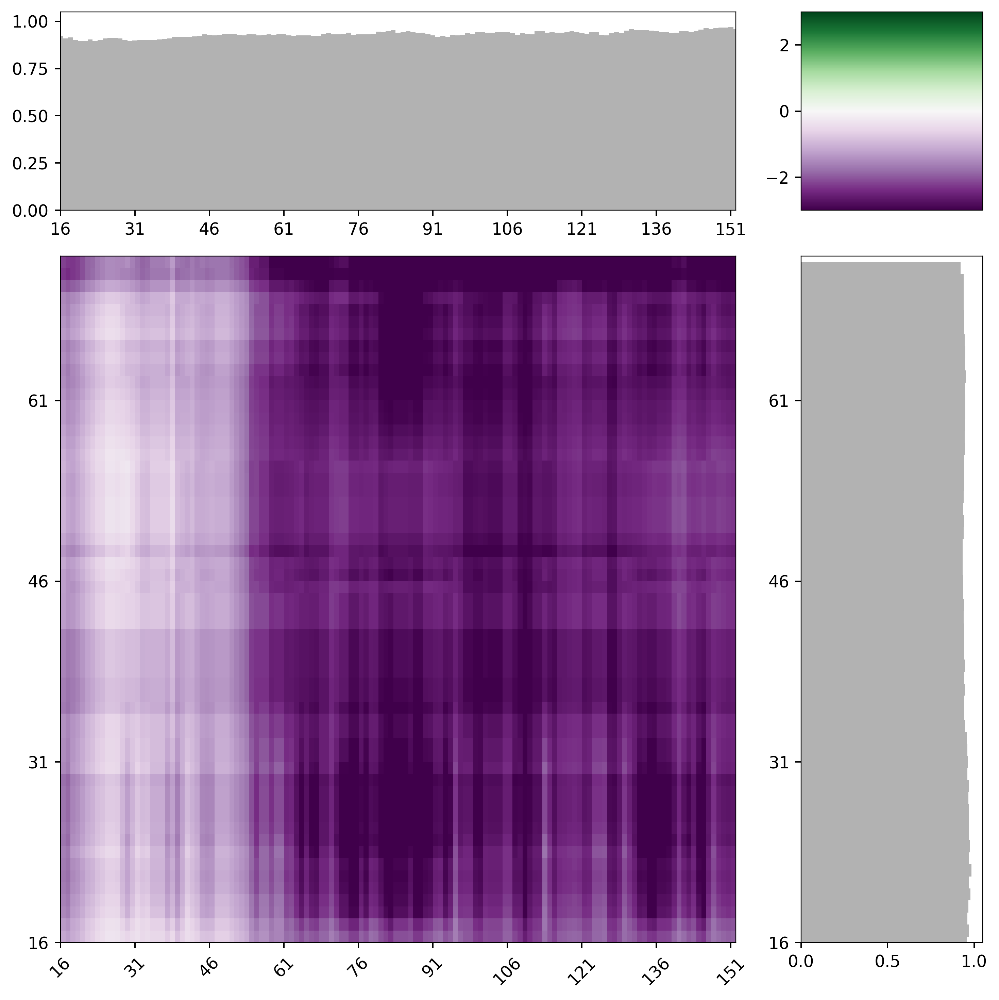
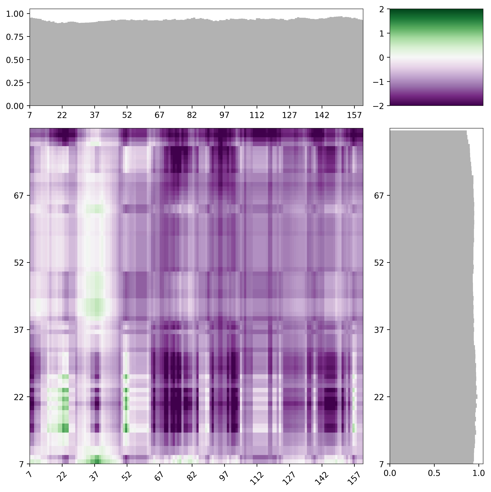

Predicting IDR:IDR interactions
====================================
For quantifying IDR:IDR interactions, FINCHES enables the rapid generation of intermaps.

What are intermaps?
---------------------

FINCHES lets you generated predicted intermolecular interaction maps (intermaps), which provide a 2D map of how two IDRs are likely to interact with one another. The x-axis is one sequence and the y-axis is the other. The color of each pixel in the intermap indicates the predicted interaction strength between the two residues at that position. We default to using purple (attractive) and green (repulsive) as our colorscheme of choice.

How do you calculate IDR:IDR intermaps?
--------------------------------------------

Intermaps can be calculated using the frontend objects

.. code-block:: python

    # import the Mpipi_frontend object
    from finches import Mpipi_frontend, CALVADOS_frontend

    # initialize the frontend objects (note can change salt)
    mf = Mpipi_frontend()
    cf = CALVADOS_frontend()

    # laf-1 RGG domain (1-168)
    s1 = 'MESNQSNNGGSGNAALNRGGRYVPPHLRGGDGGAAAAASAGGDDRRGGAGGGGYRRGGGNSGGGGGGGYDRGYNDNRDDRDNRGGSGGYGRDRNYEDRGYNGGGGGGGNRGYNNNRGGGGGGYNRQDRGDGGSSNFSRGGYNNRDEGSDNRGSGRSYNNDRRDNGGD'

    # laf-1 CTD (622-708)
    s2 = 'LEGMSGDMRSGGGYRGRGGRGNGQRFGGRDHRYQGGSGNGGGGNGGGGGFGGGGQRSGGGGGFQSGGGGGRQQQQQQRAQPQQDWWS'

    # generate the intermap; note we set the tic_frequency to 15 because these are quite short sequences
    mf.interaction_figure(s1,s2, tic_frequency=15)
    

The ``interaction_figure()`` function can take a number of additional arguments to customize the intermap. These are described in the Frontend Object API docs.

If you want the actual underlying matrix for further numerical manpulation this can be obtained using

.. code-block:: python

    # build intermolecular_idr_matrix
    (M, d1, d2) = mf.intermolecular_idr_matrix(s1,s2)

Note that here:

* ``M``: This is interaction matrix, and is itself a tuple of 3 elements. The first is the matrix of sliding epsilon values, and the second and 3rd are the indices that map sequence position from sequence1 and sequence2 to the matrix
* ``d1``: disorder profile for sequence 1. By default (``disorder_1=None``) it is predicted with metapredict; it is all 1s if ``disorder_1=False``
* ``d2``: disorder profile for sequence 2, following ``disorder_2`` in the same way

Caveats and considerations
------------------------------
1. Intermaps clip their values at the min and max; we have chosen the min and max for Mpipi and CALVADOS-based FINCHES implementations to be specific values that capture the relevant ranges, however, occassionally there will be subregions that interact much more strongly/weakly than the default min/max. This can be misleading as it may look like two pairs of sub-regionss are equally strong, whereas one may actually be much stronger than the other. However, if subregions are approach the min/max it's fair to assume these are strongly attractive/repulsive and whethere being 2x the min/max is really meaningful is less clear.

2. By default, intermaps are calculated using a windowsize of 31 amino acids (15 and 15 on each side of a central residue). This value was chosen emprically in that ~30 residue IDRs are of a length where chemical specificity can be encoded, such that using this lengthscale allows for a sliding window with reasonable chemical complexity. However, for shorter sequences it's often more useful to reduce the windowsize down. We have generally found betwee 11 and 31 to offer useful window sizes. As an example, the intermap with a windowsize of 13 is shown; it should be clear that identify subregions in the two sequences now because a bit easier with a smaller window size. 

.. code-block:: python

    # generate an intermap with a smaller window size
    mf.interaction_figure(s1,s2, tic_frequency=15, window_size=13, vmin=-2, vmax=2)

Interpreting an intermap
------------------------------
Three further tools help turn an intermap into a statement about which regions matter.

**Per-residue interaction profiles.** ``per_residue_attractive_vector()`` and ``per_residue_repulsive_vector()`` collapse the intermap along one axis. For each window of the first sequence they take that row of the intermap and report the mean of its attractive (negative) or repulsive (positive) cells only, so a window that attracts a few regions of the second sequence strongly is not diluted by the rest, and smooth the result with a Savitzky-Golay filter (``smoothing_window=None`` turns smoothing off). This gives a sticker/spacer profile of where along sequence 1 the attractive interactions with sequence 2 come from. ``protein_peptide_vector()`` is the same idea against a fixed partner, a peptide of your choosing, and has a matching ``plot_protein_peptide_vector()`` method. Every one of these methods returns a ``(positions, values)`` tuple, where the positions are 1-based residue numbers at the centre of each window.

.. code-block:: python

    # where along s1 do the attractive contacts with s2 come from?
    positions, attractive = mf.per_residue_attractive_vector(s1, s2, window_size=31)

    # binding propensity along s1 for a chosen peptide
    positions, peptide_binding = mf.protein_peptide_vector(s1, 'FYWFYW')

**Automatic region extraction.** ``finches.domain_decomposition.domain_analysis.extract_regions()`` finds rectangular blocks of an intermap that are consistently attractive (or, with ``criteria='greater'``, repulsive) and reports them as ``InteractingRegions`` objects carrying the 1-based, inclusive start and end of the interacting stretch in each sequence together with the sequences themselves. ``plot_regions_on_intermap()`` draws the blocks over the map and returns the figure and axes; it takes one colour per list of regions and raises a ``ValueError`` if the two lists differ in length.

.. code-block:: python

    from finches.domain_decomposition import domain_analysis

    # blocks where the intermap is below -0.2
    interactor_pairs, regions, intermap = domain_analysis.extract_regions(
        mf, s1, s2, criteria="less", criteria_threshold=-0.2)

    for pair in interactor_pairs:
        print(pair)

    domain_analysis.plot_regions_on_intermap(intermap, [regions], ['r'])

The main knobs are ``criteria_threshold`` (how attractive a cell has to be to count), ``baseline`` (how much of a block may fall short of that threshold), and ``min_region_area`` and ``min_region_size`` (how large a block has to be before it is reported). Note that the ``intermap`` returned here is transposed relative to ``intermolecular_idr_matrix()``: rows are ``s2`` and columns are ``s1``.

**InterLogos.** ``finches.frontend.interlogo`` renders a sequence as coloured, sized letters, in the style of a sequence logo, so that the residues driving attraction (or repulsion) with a partner can be read directly off the sequence. ``plot_attractive_logo(s1, s2, mf)`` and ``plot_repulsive_logo(s1, s2, mf)`` build the per-residue profile and draw it in one call, and ``chemical_context_seq_plot()`` draws a logo from any per-residue vector you supply. These are HTML displays intended for Jupyter.

.. code-block:: python

    from finches.frontend.interlogo import plot_attractive_logo

    # letters scaled by how strongly each residue of s1 attracts s2; residues below
    # the 70th percentile of the profile are greyed out
    plot_attractive_logo(s1, s2, mf, window_size=31, quantile_threshold=0.7)

The ``examples/overview_uses/basic_uses.ipynb`` notebook walks through all three on a real pair of IDRs.
